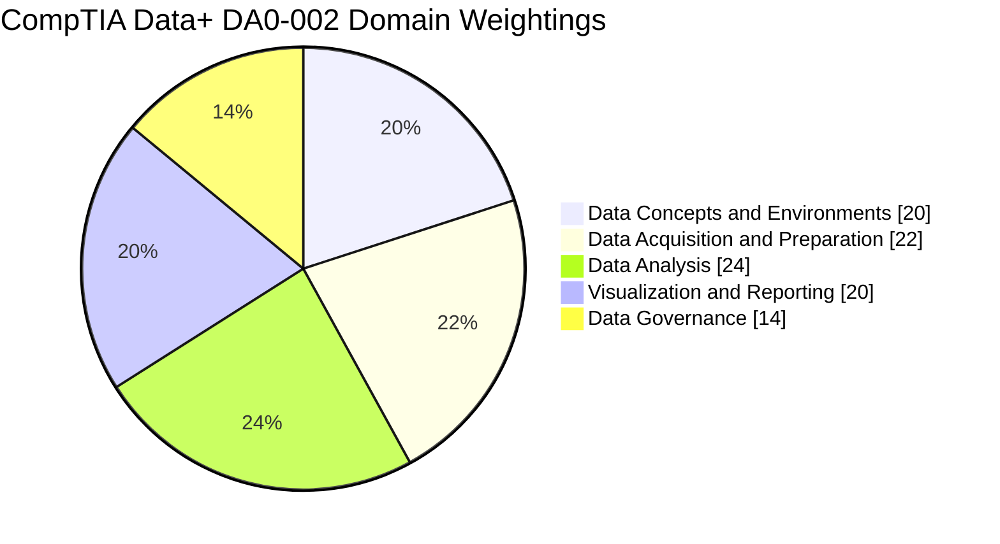
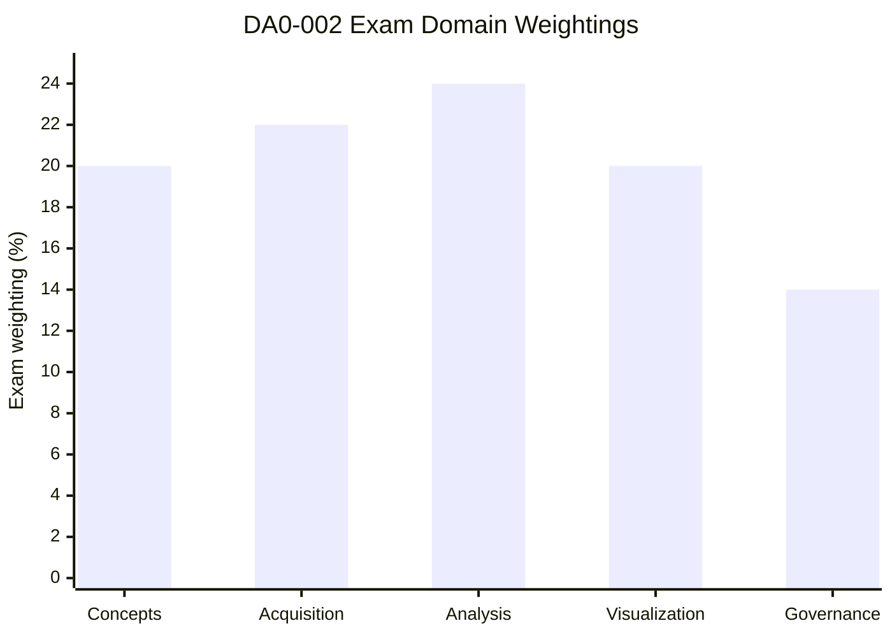
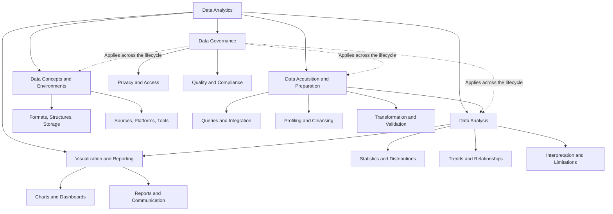
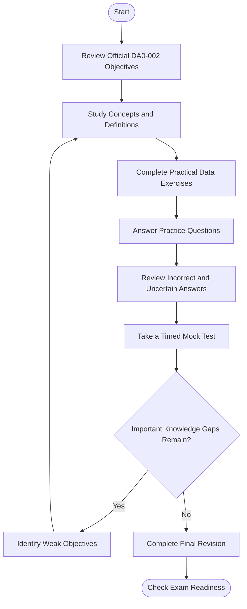
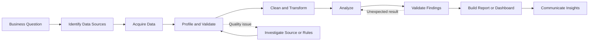
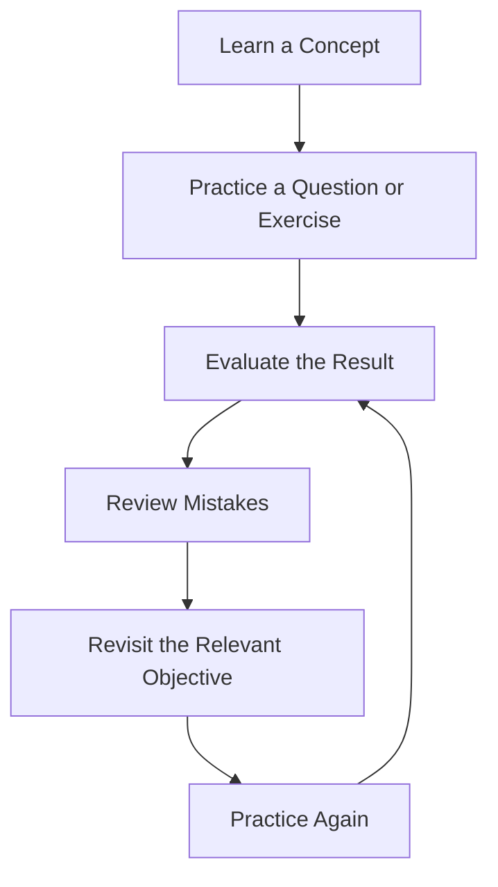
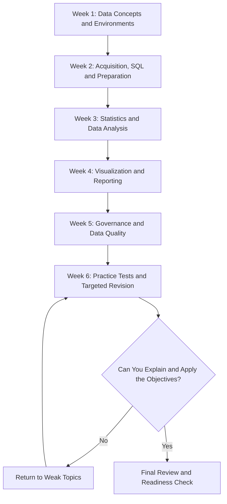

# CompTIA Data+ DA0-002 Study Guide

A practical, visual study guide for the **CompTIA Data+ DA0-002 certification**. This repository brings together data concepts, SQL and data acquisition, data preparation, statistical analysis, visualization, reporting, and data governance in one structured learning resource.

The goal is to help learners understand how data moves from raw sources to reliable, useful business insights. Use this guide with the current official CompTIA exam objectives, relevant technical documentation, and hands-on exercises.

For additional independent preparation materials, visit [CertsGate](https://certsgate.com/).

## Table of Contents

- [About CompTIA Data+](#about-comptia-data)
- [Who Should Use This Guide?](#who-should-use-this-guide)
- [Exam Details](#exam-details)
- [Official Exam Objectives and Weightings](#official-exam-objectives-and-weightings)
- [Data Analytics Skills Map](#data-analytics-skills-map)
- [Certification Preparation Flowchart](#certification-preparation-flowchart)
- [Data Analytics Workflow Diagram](#data-analytics-workflow-diagram)
- [Study and Revision Cycle](#study-and-revision-cycle)
- [Step-by-Step Preparation Strategy](#step-by-step-preparation-strategy)
- [Suggested Six-Week Study Roadmap](#suggested-six-week-study-roadmap)
- [Hands-On Projects and Practice Labs](#hands-on-projects-and-practice-labs)
- [Practice Questions and Mock Tests](#practice-questions-and-mock-tests)
- [Common Preparation Mistakes](#common-preparation-mistakes)
- [Certification Benefits and Career Relevance](#certification-benefits-and-career-relevance)
- [Frequently Asked Questions](#frequently-asked-questions)
- [Official and Additional Learning Resources](#official-and-additional-learning-resources)
- [About CertsGate](#about-certsgate)

## About CompTIA Data+

CompTIA Data+ is a vendor-neutral certification focused on the knowledge and skills used to analyze data and support data-driven decisions. Its scope covers the data lifecycle, from understanding data structures and acquiring information to preparing datasets, interpreting analytical results, communicating findings, and applying governance practices.

The current exam code covered by this guide is **DA0-002 (V2)**.

Preparing for this exam involves more than memorizing statistical definitions or SQL terminology. You should understand why a particular data-cleaning technique is appropriate, how a join can affect the number of records in a result, which visualization best communicates a finding, and how privacy requirements influence data handling.

The certification is relevant to learners interested in data analysis, reporting, business intelligence, and related analytical work.

Start with the [official CompTIA Data+ certification page](https://www.comptia.org/en-us/certifications/data) to confirm current exam information and locate the latest official objectives.

## Who Should Use This Guide?

This CompTIA Data+ study guide is intended for:

- Aspiring data analysts learning foundational analytical skills.
- Business and reporting analysts who work with spreadsheets, reports, and dashboards.
- IT professionals expanding into data management and analytics.
- Learners developing their SQL, data-cleaning, and statistical knowledge.
- Business intelligence practitioners who want to strengthen their understanding of governance and data quality.
- Candidates who prefer visual explanations, structured revision, and practical projects.

CompTIA recommends approximately **1.5–2 years of experience**, including exposure to databases and analytical tools, a basic understanding of statistics, and familiarity with data visualization.

This is recommended experience rather than a requirement that every candidate must have before beginning preparation. Learners with less experience may need more time for foundational study and practical exercises.

## Exam Details

The following information reflects the published DA0-002 exam objectives. Confirm the current details on CompTIA's website before scheduling your exam.

| Detail | Information |
|---|---|
| Certification | CompTIA Data+ |
| Exam code | DA0-002 |
| Version | V2 |
| Maximum number of questions | 90 |
| Question types | Multiple-choice and performance-based |
| Exam duration | 90 minutes |
| Passing score | 675 on a scale of 100–900 |
| Recommended experience | 1.5–2 years, with relevant database, analytics, statistics, and visualization exposure |
| Main focus | Data concepts, acquisition, preparation, analysis, visualization, reporting, and governance |

The passing score is a scaled score, not a direct percentage of questions answered correctly.

## Official Exam Objectives and Weightings

CompTIA divides the DA0-002 exam into five domains. The published weightings help you prioritize preparation, but every domain should be covered.

| Domain | Official weighting |
|---|---:|
| 1.0 Data Concepts and Environments | 20% |
| 2.0 Data Acquisition and Preparation | 22% |
| 3.0 Data Analysis | 24% |
| 4.0 Visualization and Reporting | 20% |
| 5.0 Data Governance | 14% |
| **Total** | **100%** |

### Official exam domain chart

The pie chart below represents the published DA0-002 domain percentages.

### Domain comparison chart

This bar chart presents the same official weightings in a comparison format.

These charts show exam weighting, not difficulty. A lower-weighted domain may still require substantial study if its concepts are unfamiliar.

### Domain 1.0 — Data Concepts and Environments (20%)

This domain establishes the foundations for working with data.

Review:

- Structured, semi-structured, and unstructured data.
- Data types, formats, structures, and schemas.
- Relational databases and other data storage approaches.
- Data warehouses, data lakes, and related analytical environments.
- Data sources, file formats, APIs, and data repositories.
- Cloud, on-premises, and hybrid data environments.
- Analytical tools, coding environments, and business intelligence platforms.
- Foundational AI concepts, including generative AI and large language models.

Your goal is to understand what kind of data or environment is appropriate for a particular requirement.

### Domain 2.0 — Data Acquisition and Preparation (22%)

This domain focuses on obtaining data and making it suitable for analysis.

Important concepts include:

- Data collection, sampling, and integration.
- SQL queries, joins, filtering, grouping, and aggregation.
- Extract, Transform, Load (ETL) and Extract, Load, Transform (ELT).
- Data profiling and exploratory checks.
- Missing values, duplicates, redundancy, and outliers.
- Data validation and source consistency.
- Data cleansing, transformation, standardization, and parsing.
- Derived variables, merging, appending, and imputation.

A key preparation skill is recognizing when a dataset is not ready for analysis and choosing a suitable correction rather than changing values blindly.

### Domain 3.0 — Data Analysis (24%)

Data Analysis carries the largest published weighting, so give it focused attention.

Study:

- Descriptive statistics and measures of central tendency.
- Measures of variability and distribution.
- Sampling methods and analytical limitations.
- Correlation and regression concepts.
- Hypothesis testing and statistical interpretation.
- Trend analysis and time-series concepts.
- Query results, aggregation, and analytical comparisons.
- Selecting methods that fit a business question.
- Interpreting results without overstating what the data proves.

Practice explaining what a result means, what assumptions it depends on, and what conclusions cannot safely be drawn from it.

### Domain 4.0 — Visualization and Reporting (20%)

This domain connects analysis to communication. A correct analysis can still be difficult to use if its presentation is confusing or misleading.

Review:

- Choosing suitable charts for different data types.
- Tables, bar charts, line charts, scatter plots, and other common visuals.
- Dashboard design and layout.
- Labels, titles, scales, legends, and accessibility.
- Report creation and delivery.
- Data storytelling and communicating findings to an audience.
- Identifying misleading visual choices.
- Validating reports and checking that displayed results match the underlying data.

Focus on why a visualization fits a particular question, not just how to create it in a specific product.

### Domain 5.0 — Data Governance (14%)

Data governance covers the controls and practices that help maintain trustworthy, secure, and responsibly managed data.

Review:

- Data dictionaries, metadata, and data lineage.
- Data documentation and source-of-truth practices.
- Data versioning, snapshots, and refresh intervals.
- Retention, classification, and audit requirements.
- Data privacy, ethics, and compliance concepts.
- Personally identifiable information (PII) and protected health information (PHI).
- Encryption at rest and in transit.
- Role-based access control, masking, and anonymization.
- Data quality assurance, testing, and monitoring.

Be able to distinguish protecting sensitive data from improving data accuracy. These are related but different responsibilities.

For the complete objective list, consult the current [CompTIA Data+ certification page](https://www.comptia.org/en-us/certifications/data) and use the official DA0-002 objectives linked there.

## Data Analytics Skills Map

This conceptual map shows how the main exam areas connect. It is an independent learning overview, not an additional official exam weighting chart.

The important relationship is that analysis depends on the quality of the data entering the process. Visualization communicates the results, while governance supports trustworthy and responsible use throughout the lifecycle.

## Certification Preparation Flowchart

Use this flowchart as a repeatable preparation process. The readiness checkpoint sends you back to the relevant material when important gaps remain.

This process is more useful than simply repeating questions. Each practice attempt should help you identify what you understand, what you misunderstood, and what you need to revisit.

## Data Analytics Workflow Diagram

A typical analytical task begins with a business question and ends with a result that someone can use. This example illustrates the workflow; it is not an official CompTIA architecture.

### Questions to ask at each stage

| Stage | Key question |
|---|---|
| Business question | What decision or problem should the analysis support? |
| Data acquisition | Are the sources relevant and sufficiently complete? |
| Profiling | Are there missing values, duplicates, or unexpected patterns? |
| Transformation | Are changes consistent with documented business rules? |
| Analysis | Does the method fit the question and the available data? |
| Validation | Can the result be reproduced and explained? |
| Reporting | Will the intended audience understand the conclusion and its limitations? |

## Study and Revision Cycle

Data+ preparation is iterative. Learn a concept, apply it, evaluate the result, and use mistakes to guide the next round of study.

Keep a simple mistake log with four fields:

- **Topic:** Which objective was involved?
- **Error:** What did you misunderstand or overlook?
- **Correction:** What is the right reasoning, method, or rule?
- **Retest:** Can you solve a new example without looking at the explanation?

This is especially helpful for SQL joins, missing-value handling, statistical interpretation, chart selection, and privacy scenarios.

## Step-by-Step Preparation Strategy

### Step 1: Read the official objectives

Download or open the current DA0-002 exam objectives from CompTIA. Turn each objective into a checklist and mark it as familiar, partially understood, or unfamiliar.

Do not use an older DA0-001 outline as your main plan for DA0-002. Check the exam code on books, courses, and practice resources before using them.

### Step 2: Establish a foundation in data concepts

Review data types, structures, databases, storage approaches, file formats, and analytical environments.

For each concept, explain:

- What it is.
- What problem it solves.
- When you would use it.
- What limitations or trade-offs it introduces.

### Step 3: Practice SQL and data preparation

Use a small relational dataset to practice `SELECT`, `WHERE`, `GROUP BY`, aggregate functions, and joins. Learn how to recognize duplicate rows, missing values, inconsistent formats, and unexpected outliers.

For every transformation, preserve the original data or use a reproducible workflow. Do not silently remove unusual values just because they look inconvenient.

### Step 4: Build statistical understanding

Study the meaning and appropriate use of common descriptive statistics, distributions, correlation, regression, and hypothesis-testing terminology.

Practice choosing a method for a question rather than memorizing formulas in isolation. Understand how sample size, outliers, assumptions, and data quality can affect interpretation.

### Step 5: Turn findings into useful reports

Use a spreadsheet or visualization tool to create a small report. Select charts based on the analytical question, check labels and scales, and confirm that the visuals represent the underlying data accurately.

Ask whether a reader can identify the key finding without needing an explanation of every chart.

### Step 6: Review governance and quality controls

Create a simple data dictionary, document data sources, identify sensitive fields, and propose suitable access and retention controls.

Practice distinguishing among validation, privacy protection, access management, and compliance. They may work together, but they address different risks.

### Step 7: Take practice tests and review mistakes

Use practice questions to check whether you can apply concepts in unfamiliar scenarios. Track weak domains and revisit the corresponding official objectives.

Use independent resources, including relevant study guides and practice materials on [CertsGate](https://certsgate.com/), as supplements to official documentation and practical work.

## Suggested Six-Week Study Roadmap

The following schedule is an independent recommendation, not an official CompTIA timeline. Adjust it according to your starting knowledge and the amount of time you can study each week.

| Week | Focus | Suggested activity |
|---|---|---|
| 1 | Concepts and environments | Compare data structures, sources, storage, and analytical tools |
| 2 | Acquisition and preparation | Query, join, profile, cleanse, and transform a sample dataset |
| 3 | Data analysis | Calculate descriptive statistics and interpret relationships and trends |
| 4 | Visualization and reporting | Build a report or dashboard that answers a defined question |
| 5 | Governance | Document lineage, quality checks, privacy, access, and retention |
| 6 | Review | Take practice tests, analyze errors, and revisit weak objectives |

Use the official domain weightings to guide your allocation of study time, but give extra attention to topics that you consistently struggle to explain or apply.

## Hands-On Projects and Practice Labs

Practical projects can connect abstract terminology to real data workflows. You can complete the exercises with a spreadsheet, a SQL database, Python, a notebook environment, or a visualization tool. Choose tools that are available to you rather than assuming that a particular commercial product is required.

### Project 1: Clean a messy dataset

Find a suitable public dataset or create a small synthetic dataset containing missing values, duplicate records, inconsistent text, and incorrect data types.

Tasks:

1. Inspect the columns and their data types.
2. Profile missing values and duplicates.
3. Identify suspicious values and outliers.
4. Define cleaning rules before changing the data.
5. Apply transformations and validate the output.
6. Record what changed and why.

**Learning outcome:** Understand profiling, data quality, cleansing, validation, and reproducibility.

### Project 2: Query and combine relational data

Create two small related tables, such as customers and orders.

Practice:

- Filtering rows with `WHERE`.
- Grouping records and using aggregate functions.
- Joining related tables.
- Comparing `INNER JOIN` and `LEFT JOIN` results.
- Checking for duplicate keys and unexpected row multiplication.
- Validating totals against the original data.

**Learning outcome:** Understand how query operations affect the dataset and how to check results for accuracy.

### Project 3: Analyze a business question

Use a dataset containing dates, categories, and numerical measures. Choose a question such as how sales vary by month or which product categories contribute most to total revenue.

Tasks:

1. Define the business question.
2. Check the completeness and suitability of the data.
3. Calculate relevant descriptive statistics.
4. Compare groups or examine trends.
5. Document assumptions and limitations.
6. Write a short summary of the findings.

**Learning outcome:** Practice analytical reasoning and communicate conclusions without overstating the evidence.

### Project 4: Build a report or dashboard

Use your cleaned and analyzed data to produce a report.

Include:

- A clear title and purpose.
- Suitable charts or tables.
- Labels, units, and a consistent layout.
- A small number of meaningful metrics.
- A note about important data limitations.
- A check that reported values match the analysis.

**Learning outcome:** Connect data analysis with visualization, reporting, and communication.

### Project 5: Create a governance checklist

Choose a hypothetical dataset containing personal and non-sensitive fields. Create a data dictionary and identify which fields need restricted access or additional protection.

Document:

- Data source and ownership.
- Field definitions and expected formats.
- Quality validation rules.
- Access permissions.
- Retention and deletion considerations.
- Privacy risks and protection measures.
- Procedures for reporting quality or security issues.

**Learning outcome:** Apply data governance and quality concepts to a realistic scenario.

These are independent learning exercises. They are not official CompTIA labs or a representation of the exact performance-based tasks on the exam.

## Practice Questions and Mock Tests

Practice questions can help you identify knowledge gaps, but the explanation matters more than the score alone.

A useful routine is:

1. Answer a question without immediately checking the solution.
2. Explain why the selected answer fits the scenario.
3. Identify why the other options are less suitable.
4. Connect the question to an official objective.
5. Revisit the relevant concept or practical exercise.
6. Try a different question on the same topic later.

### Original practice questions

The following questions are independently written examples for learning. They are **not official CompTIA questions** and are not intended to reproduce live exam content.

#### Question 1: Data preparation

A dataset contains several rows with the same customer ID. Before deleting any records, what should an analyst do first?

A. Delete every row with a repeated ID  
B. Determine whether the repeated IDs represent legitimate records or duplicate entries  
C. Replace all repeated IDs with random values  
D. Remove the customer ID column

**Correct answer: B**

**Explanation:** Repeated IDs do not always mean duplicate records. A customer may have multiple orders or transactions. Inspect the data structure and business rules before deciding which records, if any, should be removed.

#### Question 2: SQL joins

An analyst joins an orders table to a customer table and the resulting total revenue is unexpectedly higher. What should be investigated first?

A. Whether the report uses a large font  
B. Whether the join keys and table relationships are producing duplicated order rows  
C. Whether all date columns should be deleted  
D. Whether the data should be converted to plain text

**Correct answer: B**

**Explanation:** An incorrect join or unexpected many-to-many relationship can multiply rows and inflate aggregate values. Check key uniqueness, join conditions, and row counts before trusting the totals.

#### Question 3: Statistical interpretation

A dataset contains a few extremely large values that are far above the rest of the observations. Which measure of central tendency is generally less affected by these extreme values?

A. Mean  
B. Median  
C. Sum  
D. Maximum

**Correct answer: B**

**Explanation:** The median is based on the middle position of ordered observations and is generally less sensitive to extreme values than the mean. However, the appropriate measure still depends on the question and the distribution.

#### Question 4: Visualization

A business analyst needs to show how a measure changes over several months. Which visualization is usually a suitable starting point?

A. Line chart  
B. Decorative icon collection  
C. Randomly ordered text labels  
D. Pie chart with one slice per observation

**Correct answer: A**

**Explanation:** A line chart commonly communicates changes over time. The analyst should still verify the time intervals, aggregation method, axis scale, and data completeness.

#### Question 5: Data governance

A report includes personal information that its intended audience does not need. Which action is most appropriate?

A. Publish every field to increase transparency  
B. Remove or mask unnecessary sensitive information in accordance with the applicable requirements  
C. Share the report with a broader audience  
D. Store access credentials inside the report

**Correct answer: B**

**Explanation:** Data minimization and suitable masking or access controls can reduce unnecessary exposure. The correct treatment depends on the data, purpose, and applicable policies.

### How to use mock tests

- Begin with a diagnostic test to identify unfamiliar domains.
- Use focused practice while learning individual topics.
- Move to timed sets after you understand the underlying concepts.
- Record incorrect answers and uncertain guesses.
- Revisit the related objective and practice again.
- Use mock-test results to guide revision, not as proof that the real exam result is guaranteed.

For additional independent preparation, explore the relevant [CertsGate study and practice resources](https://certsgate.com/). Check that any resource you choose matches DA0-002 and use it alongside the official objectives.

## Common Preparation Mistakes

### Studying only statistics

Data Analysis has the largest individual weighting, but it represents 24% of the exam. Neglecting acquisition, preparation, visualization, or governance leaves substantial material uncovered.

### Memorizing SQL without understanding the output

Knowing query syntax is not enough if you cannot explain how filtering, aggregation, and joins change the results. Practice checking row counts and validating totals.

### Cleaning data without documented rules

Removing outliers or filling missing values automatically can distort findings. Investigate why values are missing or unusual and choose a method that fits the data and the analytical purpose.

### Choosing charts based on appearance

A chart should answer a question clearly. Consider the audience, data type, comparison, time period, labels, and scale before selecting a visualization.

### Ignoring data privacy and governance

Analytical usefulness does not remove the need to protect sensitive data. Learn the difference between access controls, encryption, masking, anonymization, retention, and data quality checks.

### Relying on old exam objectives

Verify that courses, books, and question banks are aligned with DA0-002. Older DA0-001 materials may use a different objective structure and should not be your only preparation resource.

### Repeating practice tests without reviewing mistakes

A high score is less useful if it comes from memorized answers. Focus on whether you can explain the reasoning and apply the concept to a new scenario.

## Certification Benefits and Career Relevance

CompTIA Data+ preparation can help learners build a structured foundation in analytical work and data management. The skills covered are relevant to responsibilities such as:

- Preparing and validating datasets.
- Querying and combining data.
- Interpreting descriptive statistics and analytical findings.
- Creating reports and dashboards.
- Communicating results to business stakeholders.
- Documenting data sources and quality rules.
- Applying data privacy and governance practices.

These skills can be useful in data analysis, reporting, business intelligence, and related roles. The value of the certification depends on the role, employer expectations, practical experience, and the other skills a candidate brings.

Certification alone does not guarantee employment, a promotion, or a particular salary.

## Frequently Asked Questions

### What is CompTIA Data+ DA0-002?

DA0-002 is the exam code for CompTIA Data+ V2. The published exam domains cover data concepts and environments, data acquisition and preparation, data analysis, visualization and reporting, and data governance.

### How many questions are on the DA0-002 exam?

The published objectives specify a maximum of 90 questions, including multiple-choice and performance-based questions.

### How long is the CompTIA Data+ exam?

The published duration is 90 minutes. Verify current details with CompTIA before booking.

### What is the passing score for DA0-002?

The published passing score is 675 on a scale of 100–900. It is a scaled score, not a direct percentage.

### Which DA0-002 domain has the highest weighting?

Data Analysis is the largest domain at 24%. Data Acquisition and Preparation follows at 22%. All five domains should still be included in your study plan.

### Do I need SQL for CompTIA Data+?

SQL and data acquisition concepts are relevant to the published objectives. Practice filtering, joins, grouping, aggregation, and interpreting query results. Check the official objective list for the complete scope.

### Do I need a specific analytics tool?

This guide recommends practicing with accessible tools such as a spreadsheet, SQL environment, notebook, or visualization application. Focus on the underlying concepts and confirm the current exam objectives rather than assuming one particular product is mandatory.

### Are the practice questions in this README official?

No. The questions are original educational examples. They are not official CompTIA exam questions and are not presented as leaked or guaranteed live questions.

### Can CertsGate replace official exam objectives?

No. CertsGate is an independent supplementary resource. Use official CompTIA documentation as the primary source for exam scope and requirements, and use additional study materials to reinforce your understanding.

### How can I assess my readiness?

Check whether you can explain the official objectives, query and prepare data correctly, interpret basic statistical results, select appropriate visualizations, and reason through governance scenarios. Use practice tests to locate weak areas and verify improvement after revision.

## Official and Additional Learning Resources

Use official resources to verify exam details, and use technical documentation to deepen your understanding of the tools and methods you practice.

### Official CompTIA resources

- [CompTIA Data+ certification page](https://www.comptia.org/en-us/certifications/data) — start here for current exam information and official preparation resources.
- [CompTIA exam policies](https://www.comptia.org/en-us/resources/test-policies) — review applicable testing policies before your appointment.
- [CompTIA training resources](https://www.comptia.org/en-us/training) — explore official training and learning options.

**Exam-objective note:** Use the current DA0-002 objectives linked from the official certification page. Confirm that the exam code and version match your planned exam before relying on an older downloaded document.

### Technical learning resources

- [SQL documentation at PostgreSQL](https://www.postgresql.org/docs/) — relational database concepts and SQL reference material.
- [pandas documentation](https://pandas.pydata.org/docs/) — data manipulation and analysis in Python.
- [Python documentation](https://docs.python.org/3/) — Python language reference and tutorials.
- [Microsoft Power BI documentation](https://learn.microsoft.com/en-us/power-bi/) — reports, dashboards, and data modeling.
- [Tableau help and documentation](https://help.tableau.com/) — visualization and analytics concepts.
- [Jupyter documentation](https://docs.jupyter.org/) — notebook-based interactive computing.

These resources support independent learning. They are not substitutes for the official CompTIA exam objectives.

### Additional preparation materials

[CertsGate](https://certsgate.com/) offers independent IT certification preparation resources. Explore the site for relevant study guides, practice questions, mock tests, and learning materials that complement your study plan.

Before using a third-party resource, check that it matches DA0-002, understand its scope, and compare its coverage against the official objectives. Practice questions should support learning and review rather than replace hands-on work.

## About CertsGate

[CertsGate](https://certsgate.com/) is an independent resource for IT certification preparation. Depending on the materials available for a particular exam, learners can use its study guides, practice questions, mock tests, and related educational content to reinforce their understanding.

For CompTIA Data+ DA0-002, a useful preparation routine is to:

1. Review the official objectives.
2. Learn the concepts behind each domain.
3. Practice SQL, data cleansing, analysis, and reporting.
4. Use questions to identify weak areas.
5. Review errors and revisit the relevant objectives.
6. Assess readiness through fresh practice and practical work.

CertsGate is included as a supplementary resource, not as an official CompTIA provider or partner.
